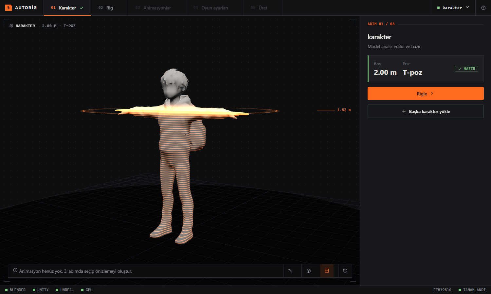
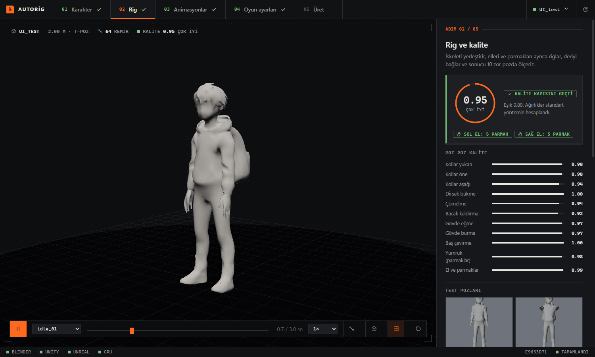
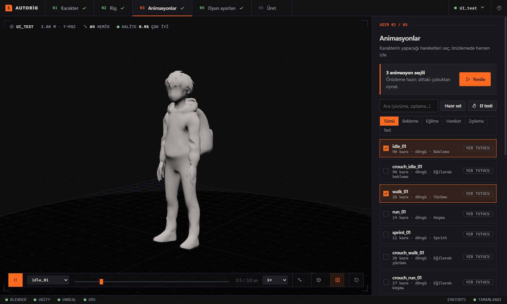
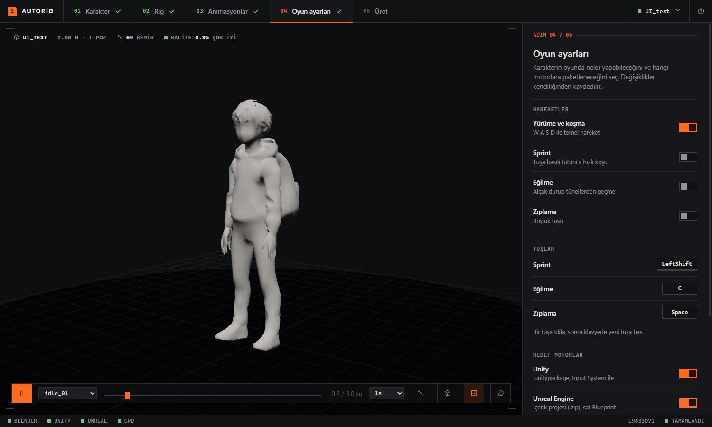

# AutoRig

> **Showcase repository.** This page presents the project. The source code lives in a private repository and is not published.

### One humanoid character in, two engine-native playable characters out: a Unity package and an Unreal project, each rigged, animated and wired to keyboard input the way that engine expects.

Unity and Unreal Engine do not agree on what a character rig should look like. AutoRig takes one humanoid model (FBX, OBJ
or GLB), rigs it with its own rigger (fingers included), **measures the skinning on ten hard poses**, and then produces
**two separate deliverables, one built for Unity (`.unitypackage`) and one for Unreal (`.zip` content project)**. Each comes
with its animations, its animation controller and **working key bindings already set up** (move, sprint, crouch, jump).
Both packages are opened in a clean project and tested automatically as part of the run. It is a desktop application that
opens in its own window; your files stay on your computer.

> The application UI is in Turkish, so the screenshots below show Turkish labels.



## Why does it exist?

Getting a character into a game normally means a rigger, a skinning pass, a hand pass, a round of "why does the elbow
collapse", and then engine setup. Auto-riggers exist, but they are usually closed services, they treat the hand as an
afterthought, and they do not tell you how good the result is. AutoRig is built around the opposite idea: **every rig is
measured, and a result that fails the quality gate is reported instead of silently accepted.**

## The two-engine problem, solved

A rig that works in one engine often needs rework in the other. The conventions differ in ways that break characters and
animations quietly:

| | Unity | Unreal Engine |
|---|---|---|
| Skeleton convention | **Humanoid avatar**; accepts at most 3 spine bones (Spine, Chest, UpperChest) | Mannequin-style skeleton with **5 spine bones**, names and hierarchy the engine's animation tools expect |
| Axes and units | Y-up, metres, +Z forward | Z-up, centimetres, different forward axis |
| Animation | Animator Controller + avatar-based retargeting | Animation Blueprint + character Blueprint |
| Input | Input System actions + C# | Enhanced Input actions + Blueprint graph |

AutoRig builds **one canonical skeleton** (Mannequin names and hierarchy, with a `root` bone for root motion) and then
derives each engine's version from it instead of exporting one file and hoping:

- **Per-engine skeleton mapping.** For Unity the five spine bones are mapped onto the three the Humanoid avatar accepts
  (`spine_01` → Spine, `spine_03` → Chest, `spine_05` → UpperChest) and the avatar is configured; for Unreal the Mannequin
  names are used.
- **Per-engine FBX profiles.** Axes, scale and bone orientation are set per engine, and each profile is verified by an
  export → re-import → measurement test rather than set by memory.
- **Animations baked per skeleton.** Every animation is retargeted onto the character and written as its own file
  (`<name>@<animation>.fbx`), with root motion handled in place and drift removed.
- **Engine-native controllers.** Unity gets a generated Animator Controller; Unreal gets an Animation Blueprint and a
  character Blueprint built as pure Blueprint (no C++ required).

### Key bindings are set up for you

Movement, sprint, crouch (toggle or hold, with or without moving) and jump are chosen once in the app, and the key for
each is yours to change (click the key, press the new one). The same choice becomes:

- **Unity:** Input System actions and a generated `PlayerController` script.
- **Unreal:** Enhanced Input actions and a Blueprint graph that drives the character.

Then each build proves it works: Unity runs EditMode and PlayMode tests in a clean project, and Unreal runs an in-game
self-test that injects the key presses and checks the character reacts.

## Pipeline

```
normalize ─► rig ─► hand ─► skin ─► qc ─► animate ─► export ─► codegen ─► unity_build ─► unreal_build ─► store
 (scale,     (64-bone  (fingers  (weights) (10 poses  (retarget  (FBX,    (input +   (package,      (content      (preview
  pose,       skeleton) from the           + hands)   + bake)    GLB)     gameplay)  clean-project  project,      images,
  facing)               mesh)                                                          test)         in-game test) video)
```

Every step writes its own folder, logs and report, results are cached by content, and a failed step stops the run with a
plain-language reason.

## Highlights

- **Our own rigger.** A proportional 64-bone skeleton fitted to the measured mesh, with three weight strategies in order:
  Blender heat weights, heat weights on a voxel proxy, and our own geometric weights. A silent binding failure on a real
  character is detected and the next strategy is used.
- **A dedicated hand module.** Fingertips are found from surface-distance persistence on the mesh, fingers are separated by
  surface Voronoi cells, each finger gets a straight centre line with a shared knuckle line, and the thumb is told apart by
  angle. If no fingers exist (mitten or fist models) the hand becomes one rigid part and a warning says so.
- **Quality control that can say no.** Ten range-of-motion poses are scored for stretching, spikes, volume loss and joint
  collapse, and a response check catches meshes that do not move at all. Fingers have their own checks (weight leakage
  between fingers, fingertip following in a fist). A geometry check warns when a mesh is too coarse to bend at a joint.
- **Both engines, tested.** Unity: clean-project import plus EditMode and PlayMode tests. Unreal: pure-Blueprint build and
  an in-game self-test that injects input. A quick mode skips the tests (Unity about 13 s, Unreal about 31 s instead of
  about 137 s and 205 s) and marks the output as unverified.
- **Your own animations.** Import FBX animations (for example from Mixamo), tag what they are for, and use them. Restricted
  licences are used with a visible warning and are never redistributed by default.
- **A desktop app that shows its work.** While a stage runs, the character turns on the stage and a scan line walks down it
  with a live height readout and a strip that fills as stages finish. Results are browsable: quality rings, per-pose bars,
  test-pose renders, an animation player with a timeline, speed, skeleton and wireframe views.

## Screenshots

| Rig and quality | Animation preview |
|---|---|
|  |  |



## Measured on a real character

A hooded AI-generated character, 3,926 vertices, about 2 m tall:

| Check | Result |
|---|---|
| Overall quality score | **0.95** (gate 0.80) |
| Finger score | **0.99** |
| Finger weight leakage | **0 %** |
| Range-of-motion poses | 0.91 – 1.00 |
| Fingers found | 5 on each hand |

On the main development character the hand module raised the finger score from 0.49 to 0.99 and cut
finger-to-finger weight leakage from 9 % to 0 %.

## Tech stack

Python · FastAPI · Pydantic · Blender (headless) · Unity 6 (C#, Input System) · Unreal Engine 5 (Blueprint) · JavaScript (ES modules) · three.js · pywebview

## Known limits

Stated plainly, because the quality gate would say the same:

- Linear skinning, which both engines use, loses some volume when an elbow bends or a shoulder lowers. Measured on the test
  character, the sleeve root thins to about 0.7–0.8 of its rest thickness in common animations; weight tuning does not
  recover it. The structural options (twist bones, an A-pose bind, corrective shapes) are not implemented.
- Thin cloth at the torso sides can show wing-like artifacts with the arms raised, and long robes break leg poses.
- Fingers that are flat wedges in the source mesh look claw-like when curled; refining the mesh does not fix that.
- Cancelling a run stops it only after the current step.
- Calibrated on a small set of characters; thresholds will need adjusting for very different styles.

## Licence

Copyright (c) 2026 Ahmet Zenginler. All rights reserved. The software and its source code are proprietary; see `LICENSE`.
